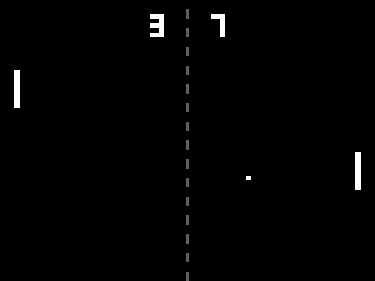
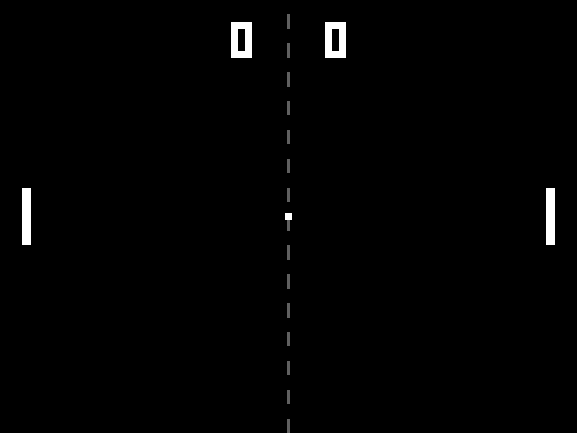
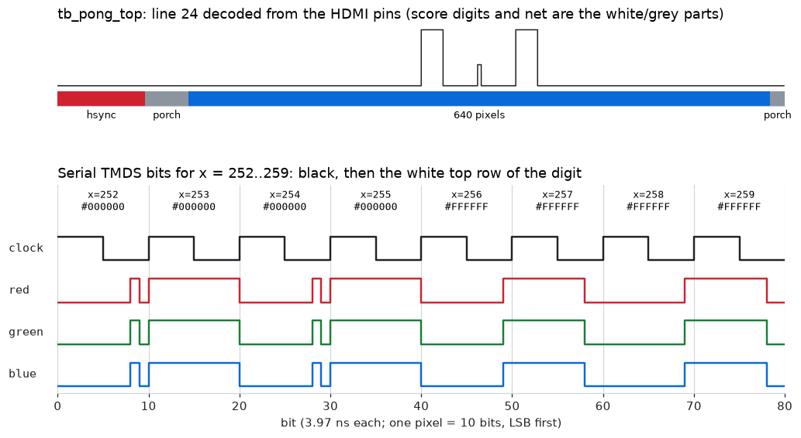
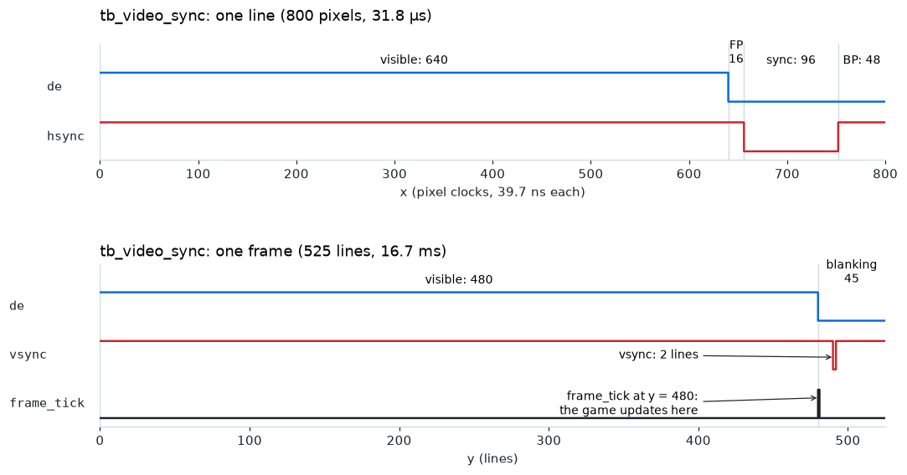
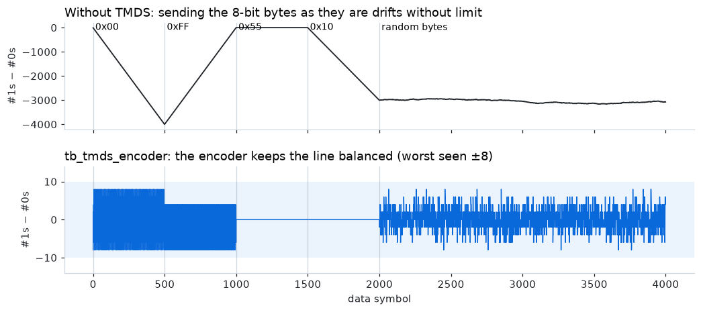
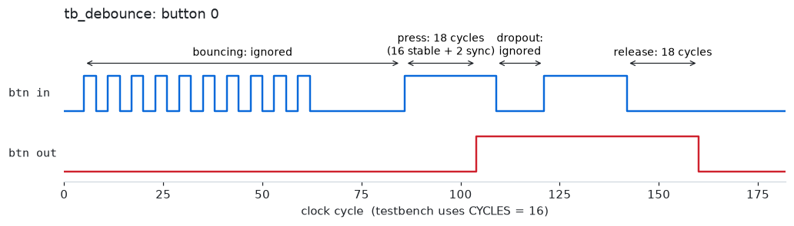

# Pong on the PYNQ-Z2

This is a two-player Pong game in SystemVerilog. It outputs 640x480 @ 60 Hz video on the
board's HDMI OUT port.

## Demo Video

https://www.youtube.com/watch?v=p-BpYY052CU

## System Architecture

```
             sysclk 125 MHz ──► MMCM ──► clk_pix 25.2 MHz / clk_5x 126 MHz
                                    │
 buttons ──► debounce ──► pong_game ──► pong_renderer ──► hdmi_tx ──► HDMI OUT
                              ▲               ▲
                              └── video_sync ─┘
```

| File | Role |
|------|------|
| `rtl/pong_top.sv`      | Top level: clock (MMCM), reset, wires the modules together |
| `rtl/debounce.sv`      | Synchronizes and debounces the buttons |
| `rtl/video_sync.sv`    | 640x480 timing: x/y counters, hsync/vsync, `frame_tick` |
| `rtl/pong_game.sv`     | Game logic and physics: paddles, ball, collisions, score |
| `rtl/pong_renderer.sv` | Pixel colour for each (x, y): ball, paddles, net, score digits |
| `rtl/hdmi_tx.sv`       | TMDS encoder and 10:1 serializers that drive the HDMI pins |

## How it works

- `video_sync` scans the screen pixel by pixel. `frame_tick` fires once per frame, when
  the visible area ends.
- `pong_game` updates once per `frame_tick`, so speeds are measured in pixels per frame.
  Nothing moves while a frame is being drawn, so there is no tearing.
- `pong_renderer` uses no frame buffer. For each pixel it checks whether (x, y) is inside
  the ball, a paddle, the net or a score digit.
- `hdmi_tx` converts each colour byte to a 10-bit TMDS symbol and sends the symbols serially
  at 10x the pixel rate.

## Controls

The left paddle uses BTN3 (up) and BTN2 (down). The right paddle uses BTN1 (up) and BTN0
(down). First to 9 points wins; after the game ends, press any button to start a new one.

## Build

```
vivado -mode batch -source build.tcl
```

To load the bitstream, set the JP1 jumper to JTAG. Then open Vivado Hardware Manager and
program `build/pong_top.bit`.

## Simulation

Self-checking testbenches for the Vivado simulator (xsim) are in `sim/`:

```
vivado -mode batch -source sim/run_sim.tcl                        # all tests
vivado -mode batch -source sim/run_sim.tcl -tclargs tb_pong_game  # one test
```

Each test prints `PASS` or `FAIL`. Logs go to `build/sim/<test>.log`.

| Testbench | What it checks |
|-----------|----------------|
| `tb_video_sync`    | Every pixel of two frames: x/y, `de`, sync pulse positions and widths, `frame_tick` |
| `tb_debounce`      | Bouncing and short glitches are ignored; a stable press shows up after `CYCLES` clocks |
| `tb_tmds_encoder`  | Control tokens; every data symbol decodes back to its byte; DC balance stays within ±10 |
| `tb_pong_game`     | Paddle movement and limits, serve pause, scoring, game over and restart; a 4000-frame rally between two computer players that checks every paddle bounce and angle |
| `tb_pong_renderer` | Edges of the ball, paddles and net, every score digit, the 1-clock pipeline. Also writes `build/sim/frame.ppm`, a picture of one frame |
| `tb_pong_top`      | The whole design with the real MMCM and OSERDES models. The bench works as an HDMI receiver: it decodes the serial TMDS pins and checks the line timing and the pixels of the first 48 lines |

`tb_pong_game` and `tb_debounce` use shorter `SERVE_DELAY` and `CYCLES` values so the tests
run fast.

### Simulation results

All six testbenches pass. The tests also write traces to `build/sim/*.csv`. To turn them into
the images below (needs Python with numpy, matplotlib and Pillow), run:

```
python sim/make_media.py
```

**One frame from `tb_pong_renderer`.** This is the renderer's output for every pixel of a
640x480 frame, with the score at 3:7.



**Gameplay from `tb_pong_game`.** This shows part of the 4000-frame rally between two computer
players, then a point where the left player misses on purpose. The positions and scores come
from the RTL simulation. Python draws them with the renderer's shapes, and `make_media.py`
checks that its drawing matches the RTL frame above pixel for pixel. The serve pause is
shortened to 3 frames in this test.



**HDMI output from `tb_pong_top`.** These are the serial pins of the whole design, with the
real MMCM and OSERDES models, decoded back into pixels. The top strip shows line 24 with its
blanking intervals, the score digits and the net. The zoom shows the 10-bit TMDS symbols on
each lane where the left score digit starts at x = 256.



**640x480 timing from `tb_video_sync`.** One line and one frame. `frame_tick` fires at the
start of vertical blanking, which is when the game state updates.



**DC balance from `tb_tmds_encoder`.** If the bytes were sent as they are, the count of 1s
and 0s on the line would drift without limit. The TMDS encoder keeps it within ±8.



**Button debouncing from `tb_debounce`.** Contact bounce and a short dropout do not change
the output. A stable press or release appears after 16 stable cycles plus 2 synchronizer
cycles. The real design uses 250,000 cycles, which is 10 ms.


